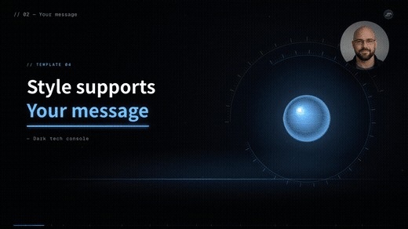
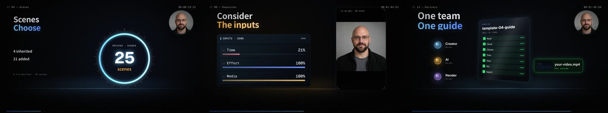

# 科技控制台 · 口播讲解

用科技控制台、紫色玻璃质感与动态信息组件配合口播，适合技术与数据说明。

**16:9 · 1920 × 1080 · 60 fps · v2.7.19-alpha.4** · [@adunext](https://motiongit.com/@adunext) · [English](README.md)

**[模板详情、完整 .motion 与 Demo](https://motiongit.com/@adunext/template-04-dark-console)**
https://motiongit.com/@adunext/template-04-dark-console

下载已开放，当前许可见模板页面与下载包。

## Demo

[查看完整样片](https://motiongit.com/@adunext/template-04-dark-console) · [播放视频](https://media.openaicut.com/previews/611/2.5.7-en-688a5e4511ae.mp4)

## 技术原理

- 声明的运行配置：adu-authored-unit/1。
- 通过模板参数和预设，将本期文字、数据或素材映射到已有动画工程。
- 模板按本期内容的语义和数量选择已制作的原生动画单元，再按包内规则组合。
- 已声明时长随本期配音适配，最终节奏由包内制作计划确定，样片时长不是固定成片时长。

样片时长: **130s**. 已声明输出为 1920 × 1080，60 fps；公开样片 130 秒。 按实际包的参数边界制作；增加素材不会自动增加场景。

## 输入素材与内容

- **可选:** 原生口播流程使用的本期人物视频与原声。
- **可选:** 与本期口播匹配的文稿或 SRT 字幕。
- **可选:** 本期主题、文稿与需要准确保留的信息。
- **可选:** 所选案例或证据镜头需要时，提供对应录屏或视频。
- **可选:** 本期已授权配乐，或本期是否需要配乐的偏好。
- **可选:** 对话中已有的主题、关键要点与输出偏好，由助手整理为方案。

适用内容: 观点口播 · 经验分享 · 回应与评论 · 教程型口播（有录屏） · 作品集口播（有作品素材）

## 运行环境

- 模板声明使用 Python 和 Node.js。具体工具与版本以下载包为准。
- 按下载包的依赖锁和 setup/check 说明检查已有工具，只补齐缺项，并验证预览。

## 使用模板

1. 从[模板页面](https://motiongit.com/@adunext/template-04-dark-console)获取当前版本的完整 .motion。
2. 按包内说明解压或加载，读取 README 和引用的制作指南。
3. 使用本期内容与素材，复用已有环境，按包内入口制作并查看实际预览。

可将下面这段请求与仓库地址交给助手：

> https://github.com/motiontemplates/553346
>
> 请使用这个 .motion 模板制作。模板地址：https://motiongit.com/@adunext/template-04-dark-console。取得模板后按其说明解压或加载，读取包内 README 和引用的指南，复用已有环境，用我的内容制作并展示实际预览。

## .motion 格式

MotionGit .motion 是可复用的视频模板格式，组织动画工程、参数、素材、依赖与制作指南。运行时按本期内容再次制作，输出 MP4 等成片。 [格式说明](https://motiongit.com/spec)

[版本、许可与完整下载](https://motiongit.com/@adunext/template-04-dark-console) · [制作参考](ASSISTANT.zh-CN.md)
